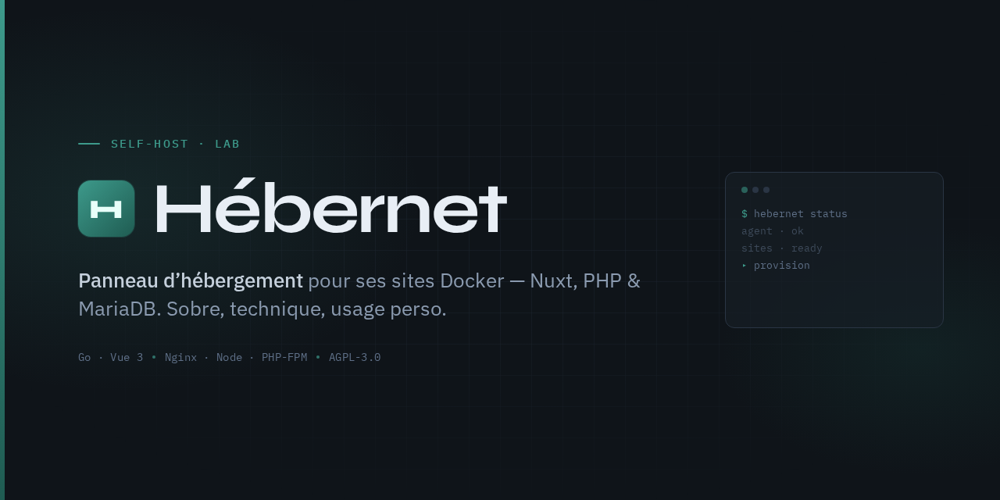

# Hébernet



<p align="center">
  <strong>Panneau d’hébergement web — usage perso</strong><br>
  Nuxt (Node SSR) · API PHP · MariaDB
</p>

<p align="center">
  
  
  
  
</p>

> Panneau pour **soi** : un type de site — **Nuxt (Node SSR) + API PHP + MariaDB**.  
> Lab / VM Ubuntu. Pas un produit commercial.

---

## L’idée en une phrase

Un panneau d’hébergement **simple** (fichiers, SSL, base, quotas) pour déployer ses propres sites Nuxt + PHP, sans usine à gaz.

| Vous apportez | Hébernet fournit |
|---|---|
| Le nom de domaine | Espace disque, compte, base MariaDB |
| Le site (Nuxt + API PHP) | Panneau + SFTP + SSL + MariaDB |

---

## Ce que contient le dépôt

```
hebernet/
├── cmd/            # Binaires agent (root) + API
├── internal/       # Cœur métier (provision, store…)
├── ui/             # Panneau Vue 3 (admin + client)
├── deploy/         # systemd + Nginx
├── scripts/        # install.sh (Ubuntu Server neuf)
└── docs/           # Install
```

### Panneau
- Rôles **admin** / **client**
- Sites : **Nuxt (Node SSR) + API PHP + MariaDB** (catalogue unique)
- Nginx : `/api` → PHP-FPM, le reste → process Node (`hebernet-node-*` : systemd ou supervisord en Docker)
- Fichiers (FileBrowser), phpMyAdmin, SSL, cron
- Pools PHP-FPM serrés par site (`pm=ondemand`, `max_children=5`, `memory_limit=128M`)
- Prérequis hôte VM : **Node.js 24 LTS** — `install.sh` via NodeSource  
  (image Docker : Node 24 inclus)
- phpMyAdmin **5.2.3** · FileBrowser Quantum **v2.0.0-stable**

### Agent
- Socket Unix, ops allowlistées
- Mode `--dry-run` pour démo sans root
- En prod : vrais `useradd`, Nginx, PHP-FPM, MariaDB

---

## Stack

| Couche | Techno |
|---|---|
| Agent | Go, socket Unix |
| API | Go, SQLite |
| UI | Vue 3 + Vite |
| Sites | Nginx · Node 24 (Nuxt/Nitro) · PHP-FPM (8.5 VM / 8.2 image Docker) · MariaDB |
| Sidecars | FileBrowser Quantum v2.0.0-stable · phpMyAdmin 5.2.3 |
| Mail (optionnel) | Resend |

Cible install : **Debian 12 / Ubuntu 24.04+** (testé aussi en 26.04).

---

## Démarrage rapide

### Démo locale (dry-run)

```bash
./scripts/demo.sh
# Panneau : http://127.0.0.1:5173/
# admin@hebernet.local / admin
```

### Ubuntu Server neuf (lab / VM)

```bash
scp -r . user@IP_VM:~/hebernet
ssh user@IP_VM 'cd hebernet && sudo ./scripts/install.sh'
```

| Service | URL |
|---|---|
| Panneau | `http://IP/` |
| Config | `/etc/hebernet/api.env` |

Comptes seed : `admin@hebernet.local` / `admin`.  
Créer un site : **Admin → Sites**.

Détail : [docs/install.md](docs/install.md).

### Docker / Portainer (perso, T330 / ZimaOS)

Stack légère sans VM — recommandée pour usage solo.  
Guide : [docs/docker-portainer.md](docs/docker-portainer.md) (compose / Portainer, Nuxt, NPM, Netbird, DNS).

```bash
# depuis le dossier hebernet-compose (à côté du code, ou stack Portainer)
cp .env.example .env
docker compose up -d --build
```

- Panneau : `http://IP_LAN:18787/`
- SSL public : **VPS** (Nginx Proxy Manager) → Netbird → `IP_T330:18787`
- DNS `A` du domaine → IP du **VPS**, pas le T330

En lab sans VPS, `/etc/hosts` :

```text
192.168.x.x  mon-site.fr www.mon-site.fr
```

---

## Sécurité

- Ne jamais exposer le socket agent sur le réseau  
- Clés Resend uniquement dans `/etc/hebernet/api.env` (hors git)  
- Quotas disque Linux optionnels (souvent absents sur VM lab)

---

## Licence

[AGPL-3.0](LICENSE) — libre d’utiliser, de modifier, de redistribuer ; les déploiements réseau doivent redistribuer le code source modifié.

---

## Évolution des versions

| Version | Contenu |
|---|---|
| V1 | Panel Go + Vue : agent Unix, API SQLite, provision sites (multi-types historiques), panneau admin/client |
| V2 | Sidecars FileBrowser + phpMyAdmin, mail Resend optionnel, install Ubuntu, vitrine + Stripe Checkout (commercial) |
| V3 | Usage perso : catalogue réduit à Nuxt (Node SSR) + PHP + MariaDB ; retrait Stripe/vitrine ; Node 24 LTS, phpMyAdmin 5.2.3, FileBrowser Quantum v2.0.0-stable |
| V4 | Stack **Docker Compose** (Portainer / ZimaOS) : agent `HEBERNET_RUNTIME=docker`, MariaDB conteneur, sans VM |
| V5 | Prod perso validée : Node 24 dans l’image, sidecars PMA, `.env.hebernet` lisible PHP-FPM, reverse-proxy VPS (NPM) + Netbird, `server_name` apex+www, `apiBase` relatif `/api` |

---

<p align="center">
  <em>Hébernet — hébergement web, pour soi.</em><br>
  <sub>Perso / lab · AGPL-3.0</sub>
</p>
